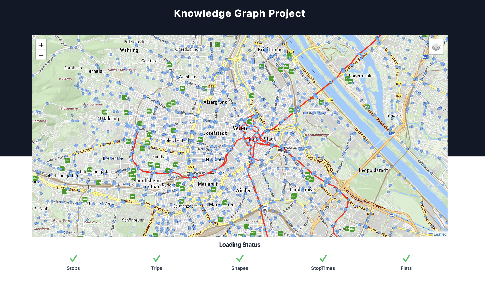

# Personalized Vienna District Browser

A knowledge graph application that combines Vienna's public transport (GTFS) and housing data to help users find districts matching their preferences (affordability, accessibility, transit connectivity).



## Architecture

- **Python pipeline** (`kg/`) — builds an RDF knowledge graph, derives district features via rule-based reasoning, learns KG embeddings (TransE), clusters districts into "lifestyle zones", and trains a GCN to score districts by user preferences. Outputs static JSON files.
- **Angular frontend** (`src/`) — Leaflet map that displays transit stops, housing markers, and a district choropleth overlay colored by cluster or suitability score.

## Prerequisites

- Node.js + Angular CLI 15 (`npm install -g @angular/cli`)
- Python 3.10+ with pip

## Data Setup (required before first run)

1. **GTFS transit data** — download "GTFS-Daten" from data.gv.at and extract into `src/assets/data/wienerlinien/`. Required files: `stops.txt`, `stop_times.txt`, `trips.txt`, `shapes.txt`.

2. **Housing data** — copy Willhaben API responses (JSON) into `helpers/wh/`, then run:
   ```bash
   python helpers/extractor.py
   ```
   Copy the generated `flat_info.json` into `src/assets/data/`.

3. **District boundaries** — download Vienna district GeoJSON from data.gv.at into `src/assets/data/districts.geojson`.

Both data directories are git-ignored.

## Running

### KG Pipeline

```bash
cd kg
pip install -r requirements.txt
python -m kg.pipeline          # runs full pipeline, outputs JSON to src/assets/data/
```

Individual stages can be run separately:

```bash
python -m kg.build_kg          # build the knowledge graph
python -m kg.reasoning         # derive district features
python -m kg.embeddings        # train embeddings + cluster districts
python -m kg.gnn               # train GNN + generate scores
```

### Frontend

```bash
npm install
npm start                      # dev server at http://localhost:4200
```

### Tests

```bash
npm test                       # Angular unit tests
cd kg && pytest                # Python pipeline tests
```
