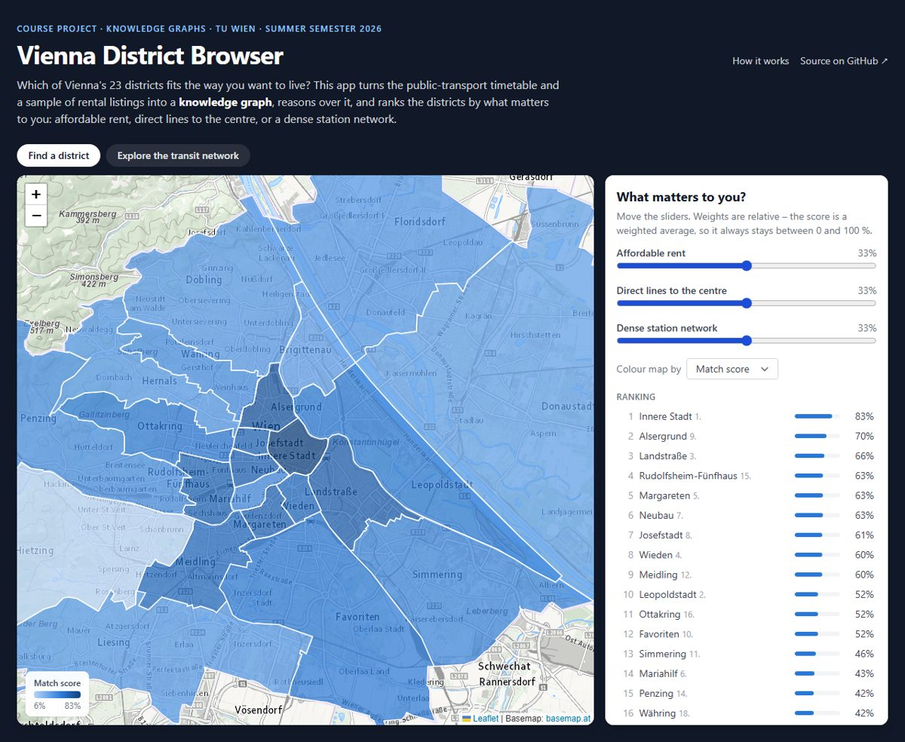
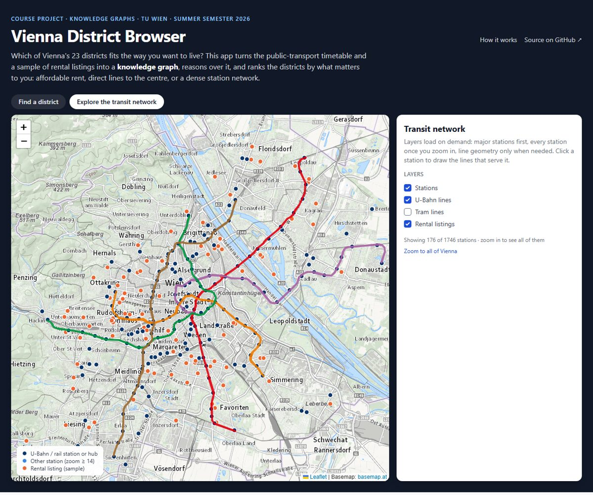
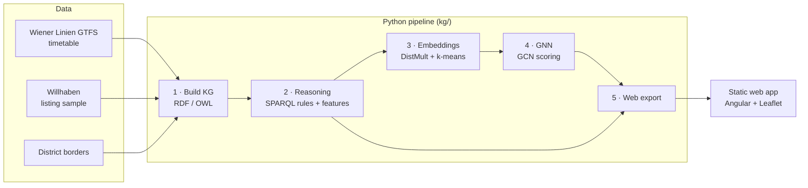

# Vienna District Browser

**Which of Vienna's 23 districts fits the way you want to live?**
A knowledge graph over Vienna's public-transport timetable and a sample of rental listings,
with rule-based reasoning, knowledge-graph embeddings and a graph neural network – served as an
interactive map that ranks districts by what matters to you.

[**▶ Open the live demo**](https://arionscheid.github.io/Vienna-District-Browser/) ·
[Transit network view](https://arionscheid.github.io/Vienna-District-Browser/?view=network) ·
[How it works](docs/ARCHITECTURE.md) ·
[Notebooks](kg/notebooks)



> **Course context.** This is my project for the *Knowledge Graphs* course at **TU Wien**
> (summer semester 2026). It applies the course's toolchain – ontology modelling in RDF/OWL,
> SPARQL-based reasoning, KG embeddings and GNNs – to a practical question. The version
> submitted for the course is commit
> [`b3e2188`](https://github.com/ArionScheid/Vienna-District-Browser/tree/b3e2188);
> what changed since is listed [below](#changes-since-the-course-submission).

## The idea

Looking for a flat in Vienna usually means trading off rent against how well connected a
place is. The open timetable data answers the second question in detail, but only at the level
of individual stops and trips. A knowledge graph lifts it to the level people decide on –
districts – and links it with rent data:

1. **Model** stations, lines, transport modes, listings and districts as an RDF graph.
2. **Reason** over it: which lines serve which district, which districts are connected without
   changing, how many direct lines go to the centre.
3. **Rank** districts with a transparent score based on *your* weights for affordable rent,
   direct lines to the centre, and station density.
4. **Learn** from the graph: embeddings group districts into "transit zones", and a GNN learns
   to score districts for any preference.

The second view of the app explores the transit network behind the graph: click a station to
see the lines that serve it.



## Pipeline



| Stage | What happens | Result (current build) |
|---|---|---|
| 1 Build KG | Platforms → stations, GTFS route variants → lines, listings cleaned, everything mapped to districts | 1,746 stations, 190 lines, 101 listings, 14,466 asserted triples |
| 2 Reasoning | SPARQL rules infer `servesDistrict` and `connectsTo`; queries derive district features | +890 inferred triples; 3 score components per district |
| 3 Embeddings | DistMult on the line–district graph, k-means on district vectors | 3 transit zones (silhouette 0.29), link prediction Hits@10 = 0.76 |
| 4 GNN | 2-layer GCN with skip connections learns the match score | Spearman ρ = 0.996 vs. the exact score on unseen preferences; same top-3 in 95 % of cases |
| 5 Export | Compact JSON for the browser | ~1.9 MB in total (instead of ~600 MB raw GTFS) |

The **match score** is a weighted average of three components in [0, 1], so it always lies
between 0 and 100 %. Details, definitions and design decisions: [docs/ARCHITECTURE.md](docs/ARCHITECTURE.md).

## Repository layout

```
├── kg/                    Python pipeline
│   ├── schema.ttl         ontology
│   ├── build_kg.py        stage 1   ── data/parsers.py, data/district_mapper.py
│   ├── reasoning.py       stage 2   (SPARQL rules + features)
│   ├── scoring.py         the match score (shared definition)
│   ├── embeddings.py      stage 3
│   ├── gnn.py             stage 4
│   ├── export_web.py      stage 5
│   ├── pipeline.py        runs all stages
│   ├── notebooks/         01 data · 02 KG & reasoning · 03 embeddings · 04 GNN
│   └── tests/
├── src/                   Angular app (map, ranking, network explorer)
│   └── assets/data/       pipeline results used by the app (committed)
├── data/                  inputs: district borders, listing sample; raw GTFS is downloaded
├── scripts/               listing extraction
└── docs/                  architecture notes, screenshots
```

## Run it locally

**Just the app** – no Python or raw data needed:

```bash
npm install
npm start            # http://localhost:4200
```

**The full pipeline** – needs the GTFS feed in `data/raw/gtfs/` ([instructions](data/README.md)):

```bash
pip install -r kg/requirements.txt
python -m kg.pipeline      # ~5 min on a laptop CPU; rewrites src/assets/data/
```

**Tests**

```bash
pytest                     # pipeline (synthetic data, no download needed)
npm run test:ci            # frontend
```

The demo is deployed to GitHub Pages by [a workflow](.github/workflows/deploy-pages.yml) on
every push to `main`.

## Limitations

* The rental sample is small and biased: ~100 of the *cheapest* listings on one day. Rent is a
  relative signal only; districts with fewer than 3 listings are shown as "no data" and count as
  average in the score.
* "Direct lines to the centre" counts lines, not travel times or frequencies.
* The GNN is trained to reproduce the transparent score, so it cannot beat it; the app uses the
  exact formula. The GNN demonstrates message passing on the graph and would become useful with
  real preference data.

## Changes since the course submission

The repository was reworked for publication. Besides documentation, a cleaner UI and the
deployment, these changes affect the results:

| Area | Before | Now |
|---|---|---|
| Match score | three independent sliders summed up → scores up to 300 % | weights normalised, weighted average → always 0–100 % |
| Missing rent data | stored as 0 → treated as the *cheapest* district | `null`, shown as "no data", neutral in the score |
| Rent statistics | mean, incl. garages, parking spots and per-day rooms (e.g. 61 €/m² in district 15) | cleaned sample, median, ≥ 3 listings required |
| Transit model | GTFS route variants (705) and platforms | lines (190) and stations (1,746) as passengers know them |
| Reasoning | `connectsTo` computed in Python while building the graph | SPARQL rules over the graph (`servesDistrict`, `connectsTo`) |
| Embeddings | TransE on near-complete `connectsTo` edges → no cluster structure | DistMult on line–district structure → geographically coherent zones |
| GNN | plain GCN over-smoothed (identical scores for several districts) | skip connections, sigmoid output, evaluated on unseen preferences |
| Web app | parsed ~600 MB of raw GTFS in the browser, one DOM marker per platform | pre-aggregated data, canvas rendering, zoom- and viewport-based layers |

## Data and attribution

Timetable © Wiener Linien and district borders © Stadt Wien, both via
[data.gv.at](https://www.data.gv.at) under CC BY 4.0 · Basemap © [basemap.at](https://basemap.at)
(CC BY 4.0) · Rental listings: a small manually copied sample from willhaben.at, reduced to
location, rent, size, rooms and type, used for academic demonstration only. See
[data/README.md](data/README.md).

## License

The code is released under the [MIT License](LICENSE). The data keeps its own terms: the
timetable, district borders and everything derived from them (`data/districts.geojson`,
`src/assets/data/`) are CC BY 4.0 – credit Wiener Linien and Stadt Wien when reusing them. The
rental-listing sample (`data/listings.json`) comes from willhaben.at and is not covered by the
MIT License.
